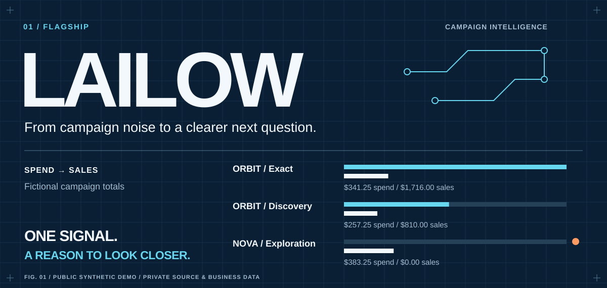
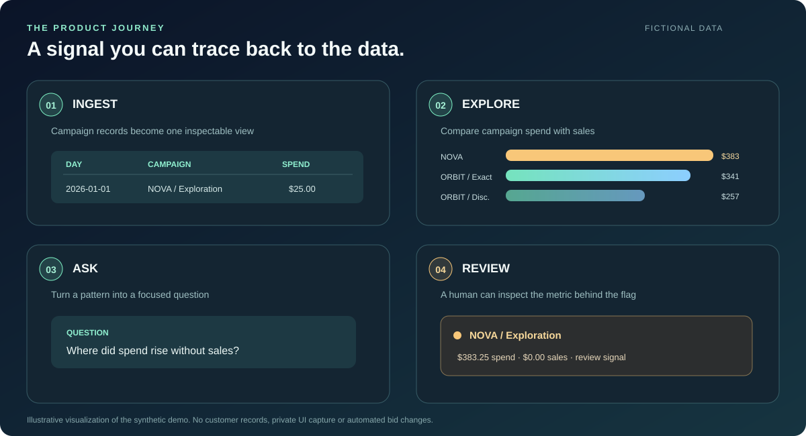

<p align="center">
  
</p>

<p align="center"><strong>Campaign data → explainable signals → a decision worth investigating.</strong></p>

<p align="center">
  <a href="#try-the-synthetic-demo">Run the demo</a> ·
  <a href="#product-walkthrough">Walkthrough</a> ·
  <a href="#architecture">Architecture</a> ·
  <a href="#engineering-notes">Engineering notes</a>
</p>

## The idea

LAILOW is a private exploration of an assistant for advertising and sales analysis. It brings campaign metrics, visual inspection and question answering into one workflow so a person can move from a broad performance view to a specific question. The original working repository contains private source and business data; it remains private.

This **public case study** shows the problem, the system shape and a small **independently written, synthetic-data** analytics slice. It is deliberately runnable with only Python's standard library. The demo is not the full application, is not connected to advertising APIs, and does not claim production deployment or measured commercial impact.

## Product walkthrough

<p align="center"></p>

*Illustrative workflow using fictional records; this graphic is not a screenshot of the private application.*

| Step | What a user does | What the system exposes |
| :--- | :--- | :--- |
| **01 · Bring data together** | Load campaign and product performance records. | A common view of spend, sales, orders, clicks and impressions. |
| **02 · Find the shape** | Compare spend, sales, CTR and ACOS across products and time. | Tables and charts that make unusual patterns visible. |
| **03 · Ask a question** | Ask for a sales summary or inspect a campaign. | Query routing to analytic or retrieval paths in the private prototype. |
| **04 · Decide what to inspect** | Review a signal and its underlying metrics. | A traceable starting point for human review, not an automatic bid change. |

The private prototype has a Streamlit dashboard with metric heatmaps, a spend-versus-sales chart, a 3D spend view and an assistant panel. Its Python code separates data/API handling, sales analysis, retrieval and the assistant loop. Some paths depend on local models, vector stores and data files. This case study does not represent every path as integrated or production ready.

## Architecture

<p align="center"></p>

**Conceptual map of the private prototype.** Data/API adapters feed preparation and stored records. A sales-analysis path computes answers from structured metrics; a retrieval path uses embeddings and a vector store; a query router chooses a response path. Streamlit provides the dashboard and assistant interface. The public demo below isolates only the structured-metric path and uses generated records instead of private integrations.

### Boundaries worth understanding

- **Metrics are explicit:** ACOS = spend ÷ sales, ROAS = sales ÷ spend, CTR = clicks ÷ impressions. Undefined denominators are reported as unavailable rather than silently replaced.
- **Signals are review prompts:** the synthetic demo uses illustrative thresholds. A high ACOS or spend without sales is a cue to inspect context, not a recommendation to change bids.
- **Privacy is a design constraint:** no client identifiers, API credentials, private prompts, real campaign records or original private code are published here.

## Try the synthetic demo

Python 3.10+ is the only requirement.

```bash
git clone https://github.com/erudaperu/LAILOW-showcase.git
cd LAILOW-showcase
python -m lailow_demo
python -m unittest discover -s tests -v
```

The default fixture generates **42 fictional daily records** across three fictional campaigns. A typical run highlights one campaign with spend and no sales:

```text
LAILOW / SYNTHETIC SIGNAL REPORT   •   42 records
CAMPAIGN                 SPEND      SALES      ACOS     ROAS
NOVA / Exploration       $ 383.25   $   0.00         —   0.00x
ORBIT / Exact            $ 341.25   $1716.00     19.9%   5.03x
ORBIT / Discovery        $ 257.25   $ 810.00     31.8%   3.15x

REVIEW SIGNALS
• NOVA / Exploration: spend without sales
```

Export the fixture or inspect machine-readable output:

```bash
python -m lailow_demo --write-sample sample.csv
python -m lailow_demo --csv sample.csv --json
```

The CSV schema is `day,campaign,product,spend,sales,orders,clicks,impressions`, with ISO dates and nonnegative numbers. The demo validates basic metric relationships. The default signal rules (`min_spend=20`, `max_acos=0.35`) were written solely for this public illustration and are **not a disclosure of private business rules**.

## Engineering notes

- The standalone demo has separate fixture, validation, aggregation and presentation modules. That separation makes the metric calculations easy to inspect and test.
- Twelve standard-library tests cover deterministic generation, aggregation, ordering, division-by-zero cases, signal boundaries, invalid input and CSV round trips.
- The private prototype combines Python, pandas, Streamlit, vector retrieval and local model tooling. This public repository intentionally does not mirror its source tree or data.
- Current limitations: the demo has no live API, model inference, deployment target or benchmark. Its synthetic signals illustrate an analysis workflow; they do not validate business outcomes.

**Built and documented by Eren Arikan.**
