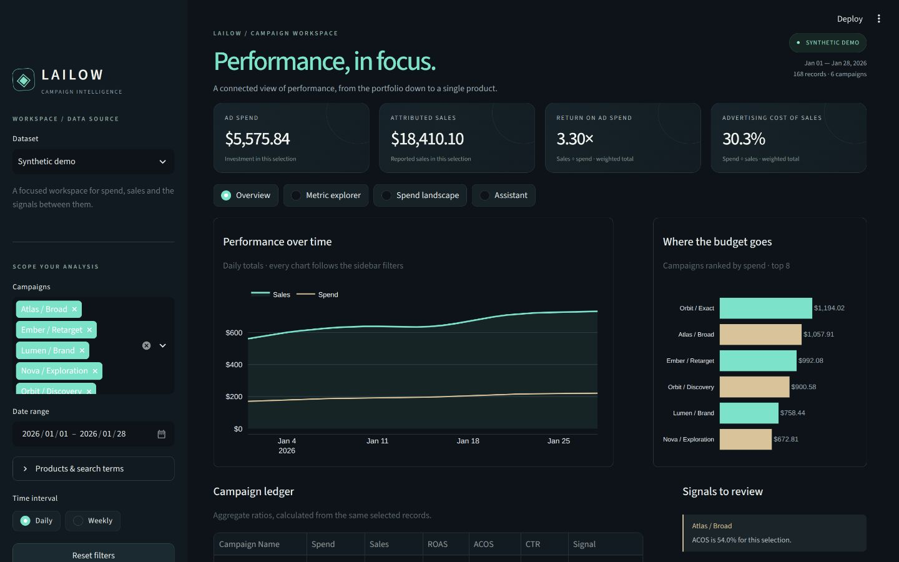
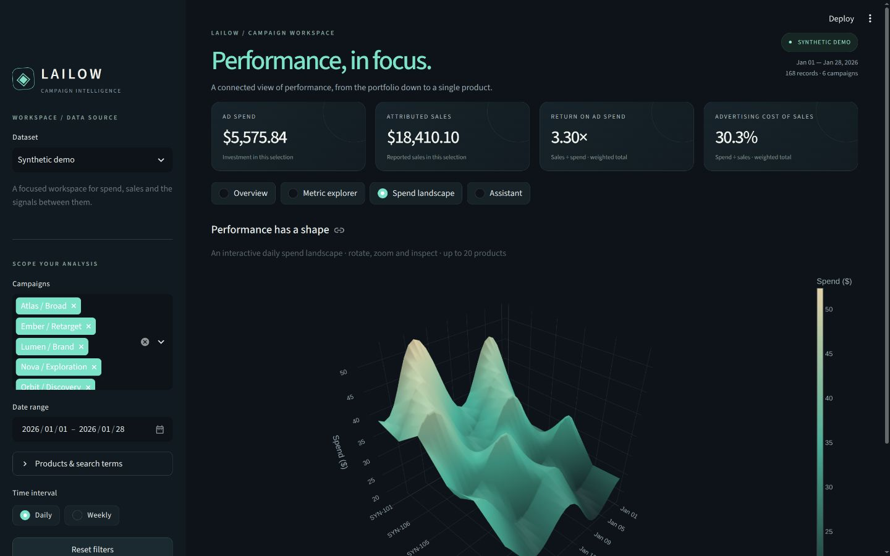
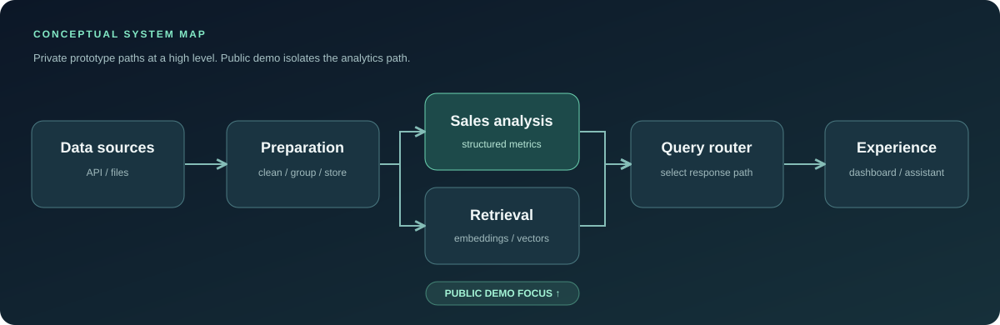

<p align="center"><strong>My workspace for campaign performance, visual exploration and question answering.</strong></p>

<p align="center"><a href="#product-walkthrough">The Streamlit interface</a> · <a href="#architecture">Architecture</a> · <a href="#try-the-synthetic-demo">Run the public demo</a></p>

I'm developing **LAILOW**, a Python and Streamlit application that connects campaign metrics, interactive analysis and an assistant. This repository is its public case study. I keep the original application source, integrations and business data in my private repository.

## Product walkthrough

The images below show **my actual Streamlit interface running with deterministic synthetic data**. They are application screenshots. The cover is generated brand artwork.



### One workspace, four ways to inspect performance

| View | What I built into the interface |
| :--- | :--- |
| **Overview** | Spend, attributed sales, ROAS and ACOS; a shared timeline; campaign rankings and signals to review. |
| **Metric explorer** | Product-by-date heatmaps for spend, sales, CTR and ACOS, with actual and normalized views. |
| **Spend landscape** | An interactive 3D view of spend across products and time. |
| **Assistant** | Dataset questions in synthetic mode, plus an explicit connection to the original private model backend when its local dependencies and data are available. |



I apply the same campaign, product, search-term and date selection across the dashboard. I recompute CTR and ACOS from aggregated totals, preserve undefined ratios, handle empty selections and support filtered CSV export. The dashboard starts with **168 fictional records across six campaigns**, so opening it does not require private files or model services.

**Assistant scope.** Synthetic-mode answers use deterministic calculations and are labelled accordingly. My existing private assistant uses local models and retrieval stores; it has a separate data context and does not automatically inherit dashboard filters. I keep that distinction visible in the interface. I have not established production deployment or measured commercial impact.

### Public demo and private application

The screenshots represent the private Streamlit application. The **separate public demo below** is an independently written, standard-library analytics slice with 42 fictional records. It lets someone run and inspect the calculations without receiving private source, integrations or business data.

## Architecture

<p align="center"></p>

**How I separate the system.** This is a conceptual map of my private prototype, alongside the implemented public demo path. Data/API adapters feed preparation and stored records. A sales-analysis path computes answers from structured metrics; a retrieval path uses embeddings and a vector store; a query router chooses a response path. Streamlit provides the dashboard and assistant interface. In the public demo below, I isolate only the structured-metric path and use generated records instead of private integrations.

### Boundaries worth understanding

- **I keep metrics explicit:** ACOS = spend ÷ sales, ROAS = sales ÷ spend, CTR = clicks ÷ impressions. Undefined denominators are reported as unavailable rather than silently replaced.
- **I use signals as review prompts:** the synthetic demo uses illustrative thresholds. A high ACOS or spend without sales is a cue to inspect context, not a recommendation to change bids.
- **I keep the public boundary clear:** I publish no client identifiers, API credentials, private prompts, real campaign records or original private code here.

## Try the synthetic demo

Python 3.10+ is the only requirement.

```bash
git clone https://github.com/erudaperu/LAILOW-showcase.git
cd LAILOW-showcase
python -m lailow_demo
python -m unittest discover -s tests -v
```

The default fixture generates **42 fictional daily records** across three fictional campaigns. A typical run highlights one campaign with spend and no sales:

```text
LAILOW / SYNTHETIC SIGNAL REPORT   •   42 records
CAMPAIGN                 SPEND      SALES      ACOS     ROAS
NOVA / Exploration       $ 383.25   $   0.00         —   0.00x
ORBIT / Exact            $ 341.25   $1716.00     19.9%   5.03x
ORBIT / Discovery        $ 257.25   $ 810.00     31.8%   3.15x

REVIEW SIGNALS
• NOVA / Exploration: spend without sales
```

I also included fixture export and machine-readable output:

```bash
python -m lailow_demo --write-sample sample.csv
python -m lailow_demo --csv sample.csv --json
```

The CSV schema is `day,campaign,product,spend,sales,orders,clicks,impressions`, with ISO dates and nonnegative numbers. The demo validates basic metric relationships. The default signal rules (`min_spend=20`, `max_acos=0.35`) were written solely for this public illustration and are **not a disclosure of private business rules**.

## Engineering notes

- I separate fixture generation, validation, aggregation and presentation so I can inspect and test the calculations independently.
- I generate the finite animation directly from the public fixture with [this optional renderer](tools/render_signal_study.py). It requires Pillow 10.1+; the analytics demo itself remains standard-library-only. The [plotted totals](assets/signal-study-data.json) are available separately.
- I use twelve standard-library tests to cover deterministic generation, aggregation, ordering, division-by-zero cases, signal boundaries, invalid input and CSV round trips.
- In the private prototype, I combine Python, pandas, Streamlit, vector retrieval and local model tooling. I keep its source tree and data out of this public repository.
- Current limitations: the demo has no live API, model inference, deployment target or benchmark. Its synthetic signals illustrate an analysis workflow; they do not validate business outcomes.

**Eren Arikan · [My GitHub](https://github.com/erudaperu)**
