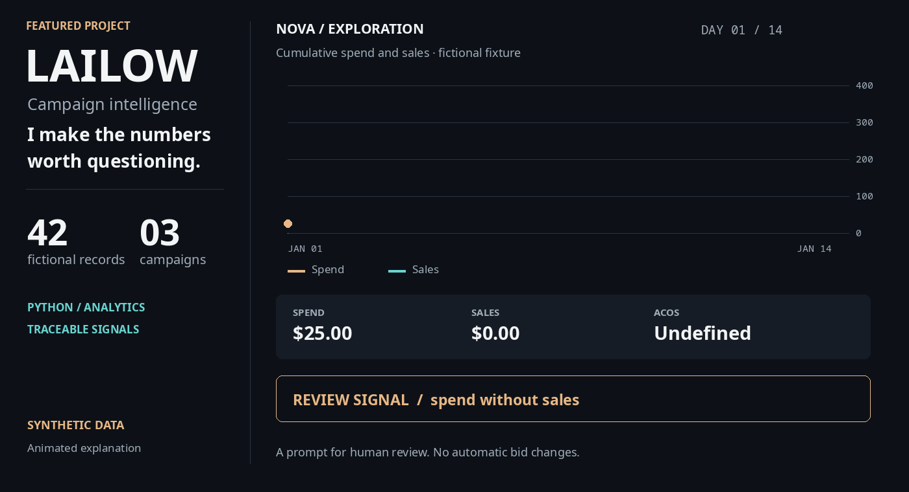

<p align="center">
  
</p>

<p align="center"><strong>Campaign data → explainable signals → a decision worth investigating.</strong></p>

*I plotted the public demo’s generated records to make this animation. It is an illustrated data study, not a screenshot of my private app. [View the static version](assets/signal-study.png).*

<p align="center">
  <a href="#try-the-synthetic-demo">Run the demo</a> ·
  <a href="#product-walkthrough">Walkthrough</a> ·
  <a href="#architecture">Architecture</a> ·
  <a href="#engineering-notes">Engineering notes</a>
</p>

## The idea

I'm building LAILOW to bring campaign metrics, visual inspection and question answering into one workflow. I want to make it easier to move from a broad performance view to a specific question worth investigating. I keep the original source and business data private.

In this **public case study**, I explain the problem and architecture, then share a small **independently written, synthetic-data** analytics slice. I made the demo runnable with only Python's standard library. It does not include the full application or connect to advertising APIs. I haven't established production deployment or measured commercial impact through this demo.

## Product walkthrough

I organize the product around four steps. This walkthrough describes the intended workflow; the public executable implements the structured analytics slice.

| Step | What a user does | What the system exposes |
| :--- | :--- | :--- |
| **01 · Bring data together** | Load campaign and product performance records. | A common view of spend, sales, orders, clicks and impressions. |
| **02 · Find the shape** | Compare spend, sales, CTR and ACOS across products and time. | Tables and charts that make unusual patterns visible. |
| **03 · Ask a question** | Ask for a sales summary or inspect a campaign. | Query routing to analytic or retrieval paths in the private prototype. |
| **04 · Decide what to inspect** | Review a signal and its underlying metrics. | A traceable starting point for human review, not an automatic bid change. |

My private prototype has a Streamlit dashboard with metric heatmaps, a spend-versus-sales chart, a 3D spend view and an assistant panel. I separate data/API handling, sales analysis, retrieval and the assistant loop. Some paths depend on local models, vector stores and data files. I don't represent every path as integrated or production ready.

## Architecture

<p align="center"></p>

**How I separate the system.** This is a conceptual map of my private prototype, alongside the implemented public demo path. Data/API adapters feed preparation and stored records. A sales-analysis path computes answers from structured metrics; a retrieval path uses embeddings and a vector store; a query router chooses a response path. Streamlit provides the dashboard and assistant interface. In the public demo below, I isolate only the structured-metric path and use generated records instead of private integrations.

### Boundaries worth understanding

- **I keep metrics explicit:** ACOS = spend ÷ sales, ROAS = sales ÷ spend, CTR = clicks ÷ impressions. Undefined denominators are reported as unavailable rather than silently replaced.
- **I use signals as review prompts:** the synthetic demo uses illustrative thresholds. A high ACOS or spend without sales is a cue to inspect context, not a recommendation to change bids.
- **I keep the public boundary clear:** I publish no client identifiers, API credentials, private prompts, real campaign records or original private code here.

## Try the synthetic demo

Python 3.10+ is the only requirement.

```bash
git clone https://github.com/erudaperu/LAILOW-showcase.git
cd LAILOW-showcase
python -m lailow_demo
python -m unittest discover -s tests -v
```

The default fixture generates **42 fictional daily records** across three fictional campaigns. A typical run highlights one campaign with spend and no sales:

```text
LAILOW / SYNTHETIC SIGNAL REPORT   •   42 records
CAMPAIGN                 SPEND      SALES      ACOS     ROAS
NOVA / Exploration       $ 383.25   $   0.00         —   0.00x
ORBIT / Exact            $ 341.25   $1716.00     19.9%   5.03x
ORBIT / Discovery        $ 257.25   $ 810.00     31.8%   3.15x

REVIEW SIGNALS
• NOVA / Exploration: spend without sales
```

I also included fixture export and machine-readable output:

```bash
python -m lailow_demo --write-sample sample.csv
python -m lailow_demo --csv sample.csv --json
```

The CSV schema is `day,campaign,product,spend,sales,orders,clicks,impressions`, with ISO dates and nonnegative numbers. The demo validates basic metric relationships. The default signal rules (`min_spend=20`, `max_acos=0.35`) were written solely for this public illustration and are **not a disclosure of private business rules**.

## Engineering notes

- I separate fixture generation, validation, aggregation and presentation so I can inspect and test the calculations independently.
- I generate the finite animation directly from the public fixture with [this optional renderer](tools/render_signal_study.py). It requires Pillow 10.1+; the analytics demo itself remains standard-library-only. The [plotted totals](assets/signal-study-data.json) are available separately.
- I use twelve standard-library tests to cover deterministic generation, aggregation, ordering, division-by-zero cases, signal boundaries, invalid input and CSV round trips.
- In the private prototype, I combine Python, pandas, Streamlit, vector retrieval and local model tooling. I keep its source tree and data out of this public repository.
- Current limitations: the demo has no live API, model inference, deployment target or benchmark. Its synthetic signals illustrate an analysis workflow; they do not validate business outcomes.

**Eren Arikan · [My GitHub](https://github.com/erudaperu)**
